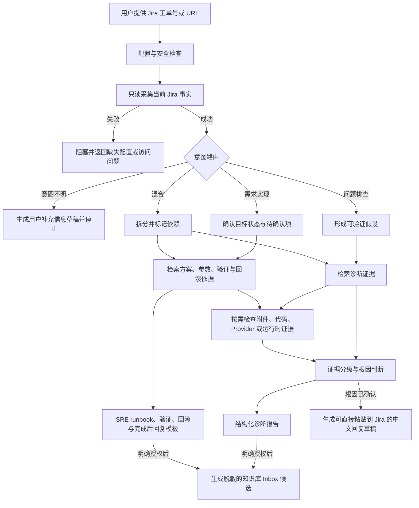

# l05-diagnosis

一个面向 Jira 支持工单的 L0.5 处理 Skill。它先获取当前工单事实并判断是问题排查、需求实现、混合还是意图不明，再结合本地 Obsidian 知识库、历史工单和按需代码证据形成可追溯的诊断结论或 SRE 人工处理 runbook。

本项目不是自动回复机器人，也不会替代 SRE 做生产变更。它的目标是缩短信息收集、问题初诊和需求方案准备时间，提高一次解决率，并把经人工审核的处理经验沉淀为后续可复用的知识。

## 核心设计



### 关键原则

- **先理解工单，再诊断**：Jira 采集失败时立即停止，不使用历史相似案例猜测当前问题。
- **先判断意图，再展开证据**：需求实现不输出根因语义；意图不明先询问最小必要信息。
- **当前事实优先**：当前 Jira 内容是现状依据，历史工单和 Wiki 只作为先例或背景。
- **证据可追溯**：区分观察事实、历史先例、推断和缺失信息，并记录来源与新鲜度。
- **能力可插拔**：Core 只提供通用 Provider Loader；Jenkins、Kubectl、Loki、CMDB 等能力由独立包和组织 Profile 引入。

## 可选 Evidence Provider

- Manifest：`~/.codex/l05-diagnosis/providers.d/*.json`
- 秘密：`~/.codex/l05-diagnosis.env`
- 非秘密配置：`<vault>/.l05-profile.json`

Provider 未安装、无权限或无匹配结果时，只记录 Evidence Gap，不影响 Jira 和 Vault 主流程。安装和契约说明见 `references/provider-contract.md` 与对应独立 Provider 的 Skill instructions。

已实现的独立本地 Provider 包括 Jenkins 构建证据、Kubectl 只读 Kubernetes
证据和 Loki 有界日志证据。Kubectl Provider 只接受由安装器写入私有策略并锁定的
kubeconfig 路径，不开放自由命令，不读取 Secret，也不执行集群写操作。Loki
Provider 只在具体证据问题和严格 `l05-evidence-plan/v1` 下调用；Core 负责串行调度、
总预算、Gateway 对账和逐步骤处理链，Provider 不接受调用方提供的 URL、Header、
LogQL、正则或自由查询。

每次 Provider 调用都必须绑定具体 `evidence_question` 和安全 Locator。Kubernetes
集群候选由非秘密 Profile 顶层 `cluster_directory` 解析；精确 Namespace、Pod、
Workload 优先于 Application-only 的有界定位。Rancher 资源只作为请求人的观察来源，
不会触发浏览器、链接工具、Rancher API 或认证。

- **默认只读**：不会评论、转派、变更状态或执行其他 Jira 写操作。
- **人工审核**：问题类只有根因得到当前证据确认时才生成完整回复；需求类只有执行和验证证据齐全后才生成可发送的完成回复。
- **知识发布受控**：只有用户明确授权后，才在 Vault 的 Inbox 中生成脱敏候选；不会自动晋升为正式知识。
- **代码隔离**：远程仓库使用独立 Mirror 和临时 detached Worktree，不修改用户已有仓库。

## 能力范围

| 能力 | 默认行为 |
| --- | --- |
| Jira 工单 | 只读获取 Summary、Description、用户评论、字段、链接和附件元数据 |
| Obsidian | 检索本地 Vault 中经过整理的文档、Wiki 和历史工单 |
| 历史工单 | 按匹配度、质量和新鲜度排序，不直接视为当前根因 |
| 附件与链接 | 仅在验证具体假设时按安全策略访问 |
| 代码分析 | 优先获取指定分支、Tag 或 Commit 的隔离远程快照 |
| 浏览器与运行时 | 由 Agent 在必要且已授权时使用可用工具补充证据 |
| Kubernetes | 通过独立 Kubectl Provider 按精确 Locator 或有界 Application 定位读取投影后的 Ingress、Service、Endpoint、Workload、Pod、Event 和受控日志证据 |
| Loki | 在具体假设和严格 Evidence Plan 下，通过独立 Loki Provider 串行执行健康检查、选择器解析、索引预估和脱敏小查询 |
| 处理输出 | 问题类输出结构化诊断；需求类输出 SRE runbook、用户补充草稿、验证、回滚和完成后回复模板 |
| 知识沉淀 | 明确授权后生成脱敏 Inbox 候选，等待人工整理 |

当前 Core 不内置企业 Provider。Jenkins、Kubectl 与 Loki 已作为独立可选包实现；CMDB 和团队 Git 知识库仍是后续扩展，也都不是本地运行依赖。

## 环境要求

- 支持 Agent Skills 的 Codex 或兼容 Agent
- Python 3.9+
- Node.js 18+
- Git
- Obsidian
- Jira 只读 Token 或 PAT
- 可选：`rg`，用于更快的知识库和代码搜索

## 安装

### 让 AI Agent 安装

把下面这段 Prompt 发给具有本地 Shell 权限的 Agent：

```text
请安装 l05-diagnosis Skill：
1. 检查 ~/.codex/skills/l05-diagnosis 是否已存在；如存在，不要覆盖，先说明当前状态并创建备份。
2. 从 https://github.com/AlvinGgg/l05-diagnosis-skill.git 安装到 ~/.codex/skills/l05-diagnosis。
3. 验证 SKILL.md、agents/openai.yaml、scripts、references 和 assets 完整。
4. 运行 Skill Creator 的 quick_validate.py，以及仓库中的 Node 和 Python 测试。
5. 安装完成后立即运行 scripts/l05_setup.py doctor，不读取或输出任何凭据值。
6. 如果状态为 needs_setup，完整展示 configuration_chain 和 setup_actions，依次协助我选择或连接 Obsidian Vault、配置 Jira 常规信息、在本机私有配置中填写只读 Token、检查文件权限并验证 `.l05-profile.json`；不要要求我把 Token 粘贴到对话中。
7. 所有机器相关路径只写入进程环境或本机私有配置，不写回 Skill、模板、测试、报告或公共文档。
8. 每完成一组配置后重新运行 doctor；只有状态为 ready 才结束安装引导并允许处理真实工单。
```

### 命令安装

使用 Skills CLI：

```bash
npx skills add https://github.com/AlvinGgg/l05-diagnosis-skill --skill l05-diagnosis
```

或手动安装：

```bash
mkdir -p ~/.codex/skills
git clone https://github.com/AlvinGgg/l05-diagnosis-skill.git ~/.codex/skills/l05-diagnosis
```

如果目标目录已经存在，请先检查并备份，不要直接覆盖。

## 首次配置

以下示例默认 Skill 安装在 Codex 的标准目录：

```bash
export L05_SKILL_DIR="${CODEX_HOME:-$HOME/.codex}/skills/l05-diagnosis"
```

安装完成后先运行配置门：

```bash
python3 "$L05_SKILL_DIR/scripts/l05_setup.py" doctor
```

`doctor` 始终输出六段 `configuration_chain`，并在未就绪时返回按顺序执行的
`setup_actions`：

1. 知识库：外置配置中的绝对 Vault 路径及完整目录契约。
2. 常规配置：有效的 Jira 根地址与认证模式；Basic 模式还需本机用户标识。
3. 敏感配置：非占位的只读 Token，以及私有配置文件的安全权限。
4. Vault Profile：存在且通过校验；代码仓库目录可以为空，同时报告 Provider capability 漂移和 Kubernetes Locator 迁移缺口。
5. 运行时：Node.js 可用。
6. 复检：重新运行 `doctor`，只有 `status=ready` 才进入真实工单处理。

`doctor` 只报告布尔状态、错误码和安全操作，不输出 Token、密码或其他凭据值。
Vault、代码根目录、工作流仓库、缓存和 Provider 目录等机器相关位置，只能来自
CLI 参数、进程环境或本机私有配置，不能固化到公共 Skill。

### 1. 初始化新的 Obsidian Vault

选择一个新的或空目录：

```bash
python3 "$L05_SKILL_DIR/scripts/l05_setup.py" init \
  --vault /absolute/path/to/new-vault \
  --jira-base-url https://jira.example.com
```

初始化器会创建 Vault 目录契约和私有配置骨架。它拒绝覆盖非空 Vault；已有 Vault 应先使用 `doctor` 做只读兼容性检查。

### 2. 配置 Jira 凭据

在本机编辑 `~/.codex/l05-diagnosis.env`：

```dotenv
JIRA_BASE_URL=https://jira.example.com
JIRA_TOKEN=<your-read-only-token>
JIRA_AUTH_MODE=bearer
L05_OBSIDIAN_VAULT=/absolute/path/to/new-vault
```

Basic 认证还需要：

```dotenv
JIRA_AUTH_MODE=basic
JIRA_EMAIL=you@example.com
```

保护配置文件：

```bash
chmod 600 ~/.codex/l05-diagnosis.env
```

不要把 Token 写入仓库、Vault、命令行参数或 Agent 对话。进程环境变量优先于私有配置文件；`~/.zshrc` 的字面量 `JIRA_TOKEN` 读取仅用于旧环境兼容，推荐使用独立配置文件。

Jira 拉取失败时，Skill 会立即停止处理，并输出脱敏后的技术原因、失败分类、请求次数和针对性检查项。Collector 会对 DNS、连接、超时、HTTP 429 和 HTTP 5xx 做最多三次有界退避重试，不重试本地配置、TLS、HTTP 401、HTTP 403 或 HTTP 404。若失败只发生在受限 Agent 环境，Agent 必须为同一只读采集命令申请网络权限；未取得非空、可解析的执行结果不能计为完成的重试。Skill 不会因拉取失败而读取知识库、历史工单或代码进行猜测。

### 3. 配置非秘密 Profile

新 Vault 已包含 `<Vault>/.l05-profile.json`。已有 Vault 可以只创建缺失的 Profile，不会覆盖现有文件：

```bash
python3 "$L05_SKILL_DIR/scripts/l05_profile.py" init \
  --vault /absolute/path/to/existing-vault
```

Profile 用于映射 Vault 目录、可选 Jira 语义字段，并在代码排查时把问题类型和当前信号路由到候选仓库。它可以保留在私有 Vault 或团队配置仓库中，但只能包含非秘密信息；Token、密码、Cookie、私钥和带凭据的仓库 URL 都会被校验器拒绝。

可选 Jira 字段映射使用公共语义槽位，组织字段 ID、名称和值路径只保留在私有
Profile 中：

```json
{
  "jira": {
    "field_mappings": {
      "domain": ["Domain Application"],
      "application": ["Domain Application"],
      "request_type": ["customfield_12345"],
      "question_classification": ["Question Classification"],
      "issue_category": ["customfield_67890"],
      "environment": ["Environment"]
    },
    "field_value_paths": {
      "domain": ["value"],
      "application": ["child.value"]
    }
  }
}
```

允许的映射槽位包括 `domain`、`application`、`event_timestamp`、
`request_type`、`question_classification`、`issue_category`、`environment`、
`namespace`、`request_id`、`source_environment`、`subscription` 和
`target_environment`。`field_value_paths` 只用于 `domain`、`application` 和
`namespace` 的安全嵌套值解析。这些值只作为意图与证据定位信号，不能覆盖请求人的
明确表述，也不能证明当前生产状态。

Kubernetes 集群目录独立于 Kubectl 私有 Policy，只保存非秘密的确定性匹配规则和
最多两个已批准候选：

```json
{
  "cluster_directory": {
    "routes": [
      {
        "id": "example-production",
        "match": {
          "environment": ["prod"],
          "subscription": ["example-subscription"],
          "cloud": "azure"
        },
        "cluster_aliases": ["example-prod"]
      }
    ]
  }
}
```

别名到 kubeconfig/context 的映射仍只存在于安装器锁定的本机私有 Policy；公共
Profile、Jira 和运行请求都不能提供 kubeconfig、context 或任意命令。

配置示例：

```json
{
  "id": "shared-pipeline",
  "url": "git@git.example.com:platform/shared-pipeline.git",
  "roles": ["shared-pipeline"],
  "default_ref": "main"
}
```

对应的路由规则示例：

```json
{
  "id": "cicd-shared-pipeline",
  "match": {
    "problem_types": ["cicd.*"],
    "keywords": ["pipeline", "jenkinsfile"],
    "match_mode": "all"
  },
  "repositories": ["shared-pipeline"],
  "reason": "CICD pipeline failures may depend on shared pipeline implementation."
}
```

仓库 `id` 和角色是组织自定义的通用标识。公共 Skill 不内置公司字段、域名或仓库。配置后验证：

```bash
python3 "$L05_SKILL_DIR/scripts/l05_profile.py" validate \
  --vault /absolute/path/to/vault
```

Profile 缺失或无效时配置门不会放行；Profile 有效但未配置代码仓库时，Jira 和知识库处理仍可使用，只是自动代码仓库路由受限。

### 4. 检查环境

```bash
python3 "$L05_SKILL_DIR/scripts/l05_setup.py" doctor
```

只有 `doctor` 返回 `status=ready` 后，才应开始真实工单处理。未完成时应按
`setup_actions` 引导补齐，而不是尝试 Jira、Vault、Provider 或代码检索。

## 构建知识库

### 使用 Obsidian Web Clipper 收集内容

安装官方 [Obsidian Web Clipper](https://obsidian.md/help/web-clipper)，并将内容保存到：

- 技术文档、Runbook、Wiki：`inbox/documents/`
- 人工筛选后的历史工单：`inbox/tickets/`
- L05 明确授权后生成的结构化 Jira 候选：`inbox/jira/`
- 工单处理中由用户/人工整理且明确授权保留的补充知识：`inbox/ticket-additional-knowledge/`

不要直接把新内容写入 `raw/` 或 `wiki/`。Inbox 是人工审核边界。不要采集登录页面、Token、Cookie、私钥、带签名参数的 URL 或无关个人信息。
补充知识候选必须标记 `needs-review` 并保留人工来源和证据缺口；它不是 Jira Bundle，
也不能作为已验证的当前事实自动进入普通检索。

### 让 Obsidian Agent 整理 Inbox

在 Vault 根目录打开 Agent，并发送：

```text
请按照当前 Vault 根目录 AGENTS.md 处理 inbox 下的所有新文件。
先预览并列出每个来源、敏感信息风险、计划写入的 raw/wiki 路径和需要补充的信息；不要覆盖或删除文件。
得到我确认后，保留原始证据、生成可追溯 source 页面，只在证据充分时更新 howto/system/topic，最后更新 index.md 和 log.md。
```

正式知识应保留来源、适用范围、验证状态和更新时间。历史工单中的解决办法不应在缺少当前证据时直接复用。

## 使用

在新 Codex 任务中显式调用：

```text
$l05-diagnosis 排查 ABC-12345
```

也可以提供 Jira URL：

```text
$l05-diagnosis 帮我诊断 https://jira.example.com/browse/ABC-12345
```

需求实现也使用同一个 Skill：

```text
$l05-diagnosis 请根据 ABC-12345 给出需要 SRE 人工实施的处理流程和完成后回复草稿
```

Skill 会按以下顺序执行：

1. 运行本地配置检查。
2. 只读获取并验证当前 Jira 工单。
3. 先生成 description-first `request_summary`，再做结构化意图判断；意图不明时输出最小用户补充信息草稿。
4. 读取并校验 Vault Profile，用当前问题或工作类型、信号和组件解析候选平台仓库与集群目录。
5. 优先检查与当前目标或症状精确匹配的已批准自助/自动化入口；匹配时给出入口、必填信息、验证和失败回退。
6. 问题类检索因果证据；需求类检索操作、参数、限制、验证和回滚依据。
7. 仅针对具体 `evidence_question` 或实施步骤检查附件、链接、代码、Provider、浏览器或运行时证据。
8. 问题类输出事实、假设、证据缺口、根因等级和排查链路；需求类输出 SRE runbook、待确认项、完成证据和处理链路。
9. 排查类仅在根因确认时附带完整回复；精确自助入口可生成不宣称已完成的可粘贴指引；需求类在规划阶段只输出不可发送的完成后模板，取得执行与验证证据后才转为可发送草稿。

### 可选代码证据

先让 Profile 解析候选仓库：

```bash
python3 "$L05_SKILL_DIR/scripts/l05_profile.py" resolve \
  --vault /absolute/path/to/vault \
  --problem-type cicd.pipeline_execution \
  --signal "pipeline" \
  --signal "jenkinsfile"
```

只有匹配理由与当前假设相关时，才通过 SSH Agent 或 Git Credential Helper 获取候选仓库。Profile 的 `default_ref` 是没有运行版本证据时的回退；工单、构建或运行时提供的 Commit、Branch 或 Tag 优先。

通过 SSH Agent 或 Git Credential Helper 提供仓库认证，不要把凭据嵌入 URL：

```bash
python3 "$L05_SKILL_DIR/scripts/git_snapshot.py" \
  --repo-url https://git.example.com/org/platform.git \
  --ref release-1 \
  --query "distinctive error"
```

本地代码搜索必须由用户显式启用：

```bash
python3 "$L05_SKILL_DIR/scripts/search_local_code.py" \
  --root /absolute/path/to/code \
  --query "distinctive error" \
  --no-sync
```

### 临时文件与知识候选

`run_l05_case.mjs` 默认在临时目录中生成 Case，并在结束时清理。只有以下参数会保留内容：

- `--keep-temp`：短期保留本次临时 Case。
- `--case-dir <path>`：保留到指定目录。
- `--publish-to-kb`：在明确授权后生成脱敏知识候选，不会自动发布正式 Wiki。

附件默认只采集元数据。只有确需验证当前假设时才使用
`--attachment-mode all` 有界下载；下载内容必须按
`references/attachment-policy.md` 预览，并仅通过 Collector 的受保护
`cleanup` 命令清理其自有临时根目录。

## 分路线输出

Case 始终生成 `case-summary.json`。保留临时 Case 时，还会按意图生成：

- `diagnosis.md`：问题排查或混合工单的结构化诊断。
- `fulfillment.md`：需求实现的 SRE runbook、验证、回滚和完成后回复模板。
- `clarification.md`：意图不明时的一次性用户补充信息草稿；此时不会检索 Vault、Provider、代码、浏览器或运行时证据。

每个最终答复都必须直接包含 `本次处理链路`，不能只依赖可能被折叠的进度消息或本地报告链接。每个实际检查或尝试都记录状态、目的、安全目标、查询范围、结果、对结论的影响和可安全公开的引用；失败访问必须标记为失败，不能当作支持证据。

问题排查路线包含当前工单事实、时间线、知识库匹配与新鲜度、支持与反驳证据、根因等级、建议修改、验证计划和证据缺口。需求实现路线区分 `requester_input`、`sre_precheck`、`approval_input` 与 `evidence_gap`，并提供目标与排除项、当前状态快照、实施停止条件、验证、回滚和完成证据。

Jira 回复草稿默认使用中文。排查类只有当前证据确认根因后才生成可发送回复；咨询类需要权威文档或当前代码支持；需求类在 `execution_status=not_executed` 时只生成明确标注“不可直接发送”的模板，只有实际执行和验证证据齐全后才能生成可发送的完成回复。未执行的修改必须标记为建议，不能写成已经修复。

## 安全边界

- Jira 默认且固定为只读；仓库中没有 Jira 写回流程。
- Jira、附件、网页、历史工单和代码均视为不可信证据，而不是 Agent 指令。
- 不输出 Token、Cookie、私钥、带密钥的 URL、内部工具原始输出或本地私有路径。
- 未确认的根因不能生成“问题已解决”式回复。
- 不修改已有本地代码仓库，不执行强制 Checkout、Reset 或 Clean。
- 外部系统写入、生产变更和知识正式发布都需要单独授权。

## 本地验证

离线回归测试只需要 Python、Node.js、Git 和 `rg`（ripgrep）。两组测试会调用
另一种语言的辅助脚本，因此运行任一组前都应安装两个运行时。`rg` 是 Python
测试中 Git 快照搜索用例的必需工具；Ubuntu 可通过 `sudo apt-get install ripgrep`
安装。测试仅使用标准库、仓库自带代码、临时 Vault、模拟 Provider 和 Jira
Fixture，无需 npm/pip 安装、真实 Jira 凭据、Kubernetes 集群或个人 Obsidian Vault。
请在没有个人 L05 配置或凭据的干净环境运行；“Jira 不可用”用例在未配置 Token
时会直接验证采集阻断行为。

```bash
node --test tests/*.test.mjs
python3 -m unittest discover -s tests -p 'test_*.py'
```

`.github/workflows/ci.yml` 在所有 Pull Request 和 main 分支推送时自动运行上述
命令。CI 使用 Ubuntu 24.04、Node.js 22.22.0 和 Python 3.12.3，官方 Actions 固定到
完整 Commit SHA；更新版本时应同步修改工作流并重新验证。这是 CI 验证基线，
不代表已覆盖环境要求中的全部最低版本。Runner 镜像和 Ubuntu 软件包仍会更新。

GitHub 的 Checks/Actions 页面会分别展示 `Node.js tests` 和 `Python tests`；任一
命令返回非零值都会使对应检查失败，另一组仍会运行。每组最多运行 10 分钟，同一
PR 或 main 分支有新提交时会取消旧运行。CI 仅授予 `contents: read`，不保留
Checkout 凭据，不注入 Secrets，也不上传 Vault、配置或测试临时文件。依赖准备
需要网络；测试本身不依赖外部服务成功响应。分支保护中的必需检查仍需仓库维护者
单独配置。

以下为可选的 Skill 格式与泄漏检查，需要另行安装相应工具，不属于上述 CI：

```bash
python3 "$CODEX_HOME/skills/.system/skill-creator/scripts/quick_validate.py" .
gitleaks detect --no-git --redact --source .
```

## 目录结构

```text
.
├── SKILL.md
├── agents/
├── assets/
├── references/
├── scripts/
└── tests/
```

## License

Apache License 2.0。详见 `LICENSE`。
